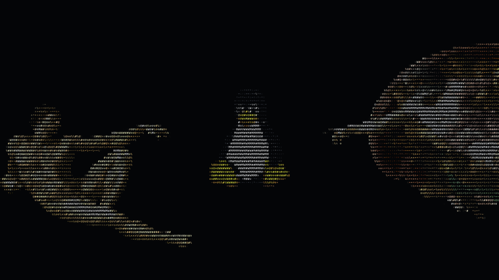

# Creation of Tux

**Native animated ASCII wallpaper for Wayland.** A rotating Tux between the
figures from Michelangelo's *Creation of Adam*. Real-time GPU rendering,
subtle character shimmer and stable eyes — no video loop or browser runtime.

By **Ch3L1k** · [Русская инструкция](docs/README.ru.md)



[Watch the animation](docs/demo.mp4)

## What you get

- Standalone operation: **Noctalia is optional**.
- Native GTK4 control window: start/stop, detail, FPS, rotation, size and monitors.
- Command-line controls usable from any launcher, bar or keyboard shortcut.
- Per-user installation and removal, without sudo.
- Optional login autostart; existing desktop settings are not rewritten.
- Multi-monitor output filtering and hotplug handling.

## Compatibility

Linux, Wayland, **wlr-layer-shell**, EGL/OpenGL ES 2 and a working graphics driver.
Tested on CachyOS/Hyprland. Sway and niri implement the required protocol, but
this release has not been interactively tested on those desktops.
Stock GNOME, X11, Windows and macOS are **not supported** by this backend.
Other wallpaper programs can cover the same background layer: start this
wallpaper last, or use `creation-of-tux refresh` after changing wallpaper tools.
The optional Hyprland watcher handles known wallpaper-layer recreation events.

## Install

Download and extract the source ZIP from GitHub, or clone the repository.
Install the dependencies below, then in the extracted folder run:

```sh
python3 install.py
```

The installer builds locally if needed and installs under your user data directory
(usually `~/.local/share/creation-of-tux`). Open **Creation of Tux** from the app
launcher. Nothing starts until you press **Start**.

You can also run:

```sh
~/.local/bin/creation-of-tux start
```

The settings window needs GTK4 + PyGObject. Without those, rendering and all CLI
commands work normally. Add `~/.local/bin` to PATH if your distribution does not
already include it. Installation from a source checkout rebuilds when sources
are newer than the existing binary. A packaged binary is specific to its CPU
architecture and system libraries; building locally is the portable default.

### Dependencies

Build/runtime package names for common distributions:

```sh
# Arch / CachyOS / EndeavourOS
sudo pacman -S --needed base-devel pkgconf wayland wayland-protocols mesa libglvnd libpng python
# Optional settings window
sudo pacman -S --needed python-gobject gtk4

# Debian / Ubuntu
sudo apt install build-essential pkg-config libwayland-dev wayland-protocols libegl1-mesa-dev libgles2-mesa-dev libpng-dev python3
# Optional settings window
sudo apt install python3-gi gir1.2-gtk-4.0

# Fedora
sudo dnf install gcc-c++ gcc pkgconf-pkg-config wayland-devel wayland-protocols-devel mesa-libEGL-devel mesa-libGLES-devel libpng-devel python3
# Optional settings window
sudo dnf install python3-gobject gtk4
```

Package lists outside Arch have not been tested on a real installation.
The installer does not run your package manager or download executable code.

## Controls

```sh
creation-of-tux                  # settings window
creation-of-tux start
creation-of-tux stop
creation-of-tux toggle
creation-of-tux restart
creation-of-tux status
creation-of-tux configure eco     # 180 columns / 24 FPS
creation-of-tux configure balanced # 260 columns / 30 FPS
creation-of-tux configure detailed # 360 columns / 60 FPS
creation-of-tux configure '{"fps":30,"period":12,"output":"DP-1"}'
creation-of-tux doctor           # protocol/output checks and log location
creation-of-tux refresh          # re-map background surfaces
```

Default: 260 columns, 30 FPS, 9-second rotation, Tux scale 0.65, all monitors.
The renderer accepts comma-separated output names. Find them with `doctor`.
Settings: `$XDG_CONFIG_HOME/creation-of-tux/settings.json`.
Logs: `$XDG_STATE_HOME/creation-of-tux/renderer.log`.
Usual defaults are `~/.config` and `~/.local/state`.
Malformed settings produce an error rather than silently changing your desktop.

## Autostart

Enable **Start when I sign in** in the settings window, or:

```sh
creation-of-tux autostart on
creation-of-tux autostart off
```

This creates a standard XDG autostart entry. Some standalone compositors do not
launch XDG autostart entries. In that case add one command using your existing
session-startup mechanism, **instead** of enabling duplicate startup methods:

```text
# Hyprland .conf
exec-once = ~/.local/bin/creation-of-tux start

# Sway config (use your actual home path)
exec /home/YOUR_USER/.local/bin/creation-of-tux start

# niri config.kdl
spawn-at-startup "/home/YOUR_USER/.local/bin/creation-of-tux" "start"
```

Hyprland Lua configurations should use their normal exec-once API instead of
pasting .conf syntax. No compositor configuration is edited by this installer.

## Remove or update

```sh
python3 ~/.local/share/creation-of-tux/install.py --uninstall
```

Uses `$XDG_DATA_HOME` if customized. Preferences/logs are kept for a future
reinstallation; delete their specific `creation-of-tux` folders if you want to
reset them. Updates use the same install command from a new source checkout.
Updating stops the previous instance. Start again after installation.

Advanced: `python3 install.py --prefix /absolute/custom/prefix` installs into
that prefix's `bin` and `share`. Pass the same `--prefix` when removing it.

## Optional Noctalia picker integration

Standalone mode is the default and needs no Noctalia files. For the normal
Noctalia v5 wallpaper picker, see [the adapter instructions](docs/noctalia.md).
Do not enable it alongside the earlier personal `creation-ascii` integration.

## Build and verify

```sh
bash build.sh
./build/creation-ascii --version
./build/creation-ascii --list-outputs
./build/creation-ascii --snapshot /tmp/creation-of-tux.png --phase 0 --time 0
python3 -m unittest discover -s tests -v
```

Unit/integration tests use temporary homes and fake renderers. They do not
replace your running wallpaper. GPU snapshot checks require a compatible live
Wayland session and are documented in [testing notes](docs/TESTING.md).

## Credits and license

Original code: MIT, **Ch3L1k**. Artwork and protocol/font components have separate
attributions — see [THIRD_PARTY.md](THIRD_PARTY.md) and [LICENSES](LICENSES).
Developed with AI coding assistance; image frames are procedural ASCII, not
image-model output. No accounts, telemetry, credentials or network connection
are needed to run the wallpaper.
